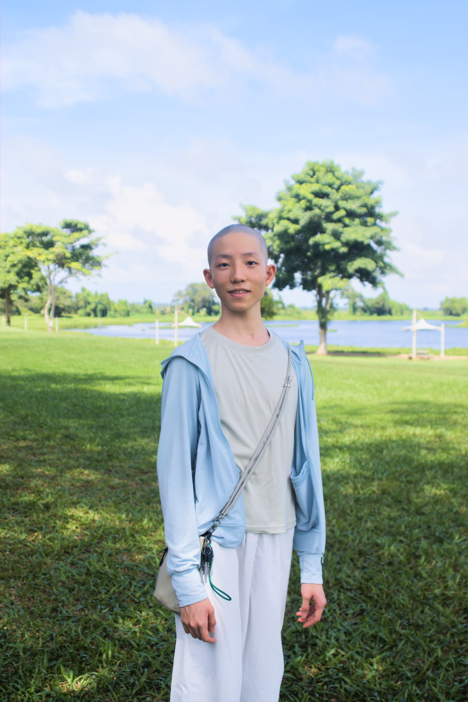
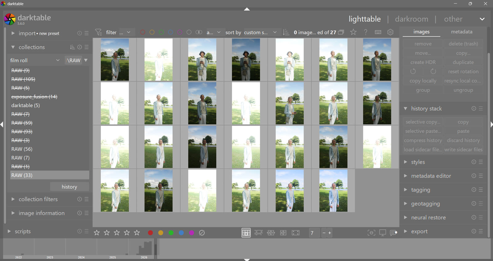
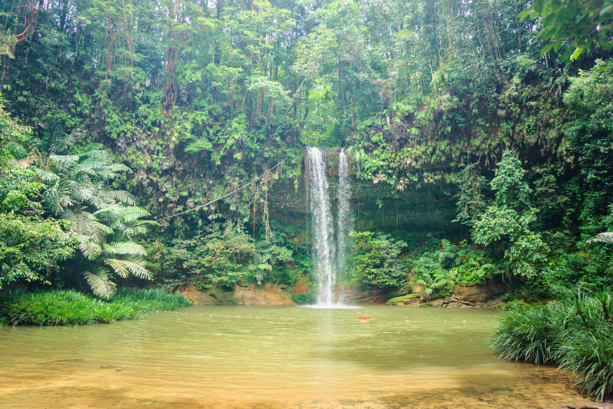
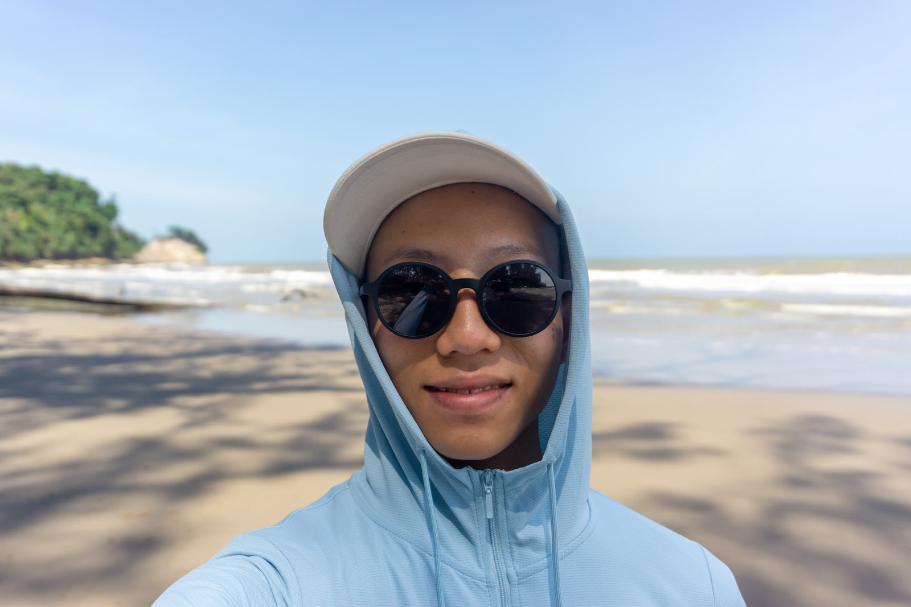
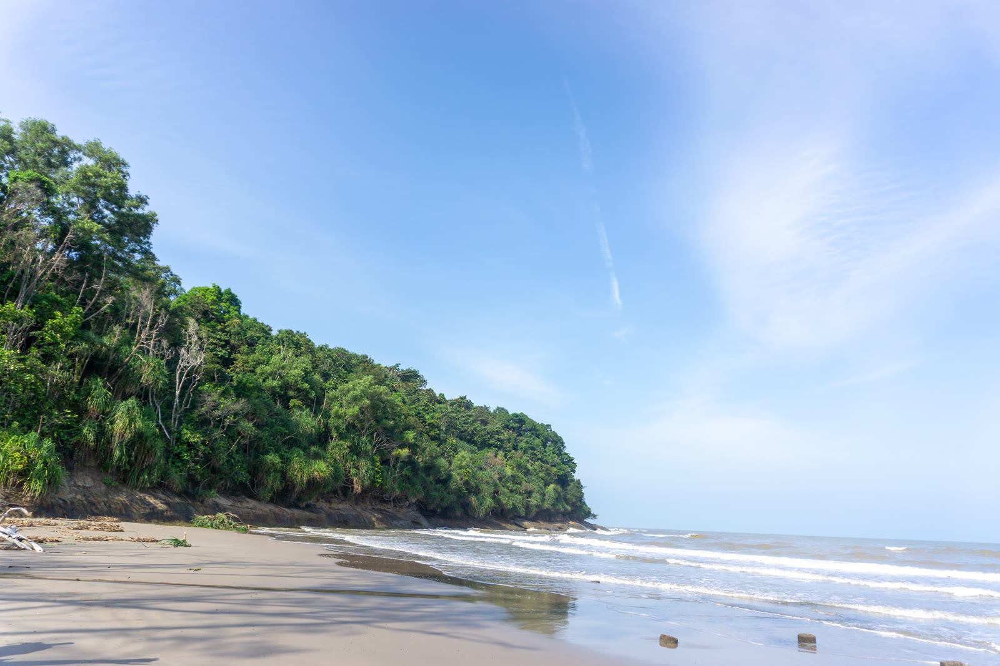
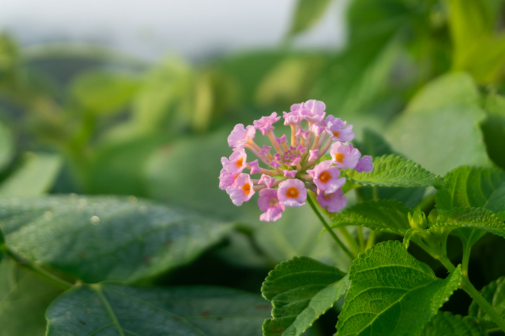
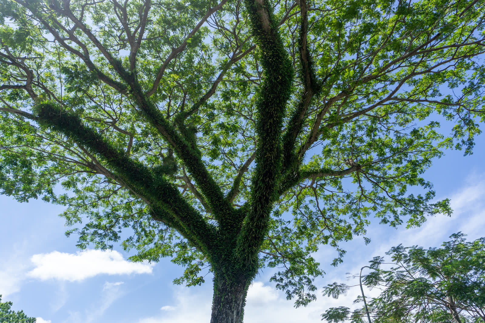

I photograph nature, often with myself in the frame. I love how light falls on the whole scene: the sky, land, trees and people. That led me into HDR, because a scene's wide range of light has to be mapped down to what a screen can show.

**From Adobe to Darktable**

- I spent about a year comparing RAW workflows, mostly for HDR.
- I started with **Lightroom**, which was stable but less flexible when the light contrast is extreme. **Photoshop** let me merge HDR from several exposures with careful masks.
- I have not used either for about a year. Today I use only **Darktable**. It gives me the freedom to pull brightness where I want it, and it is enough for what I need.

