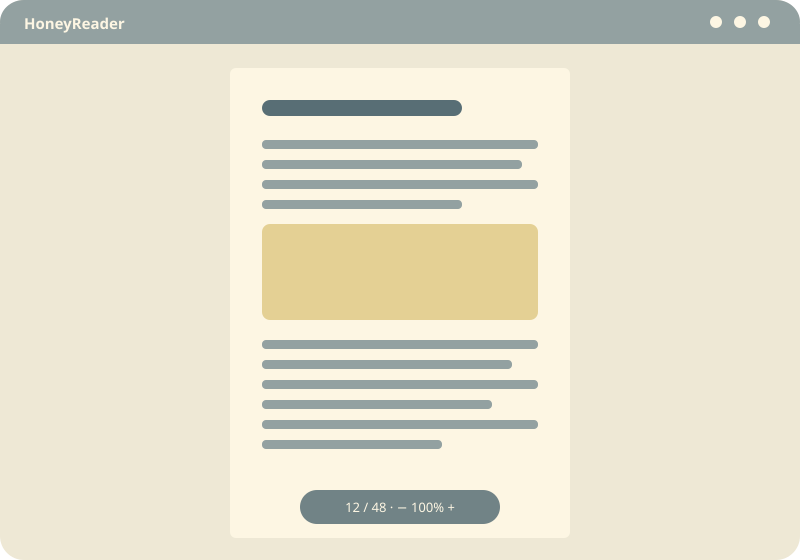
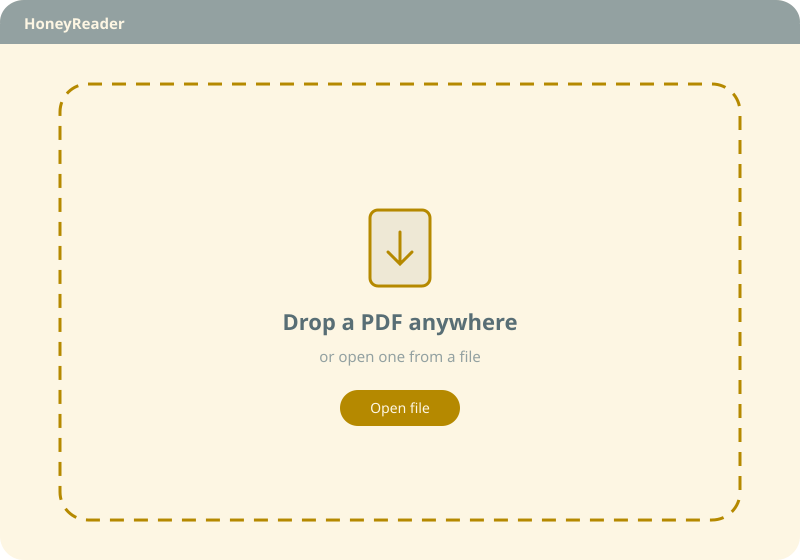
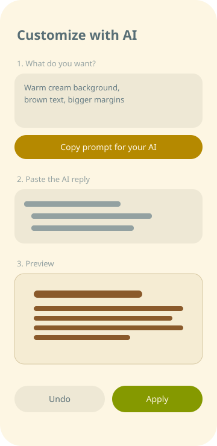

**Upcoming · open source · long-term project**

HoneyReader is a calm PDF reader for Windows and Android, made for people who read for hours and have sensitive eyes.

**Planned features**

- Solarized light theme, plus custom text and background colors.
- Drop a PDF anywhere in the window to open it.
- Few buttons, so the page stays the focus.
- "Customize with AI": paste a config from any AI chat, preview it, apply or undo.

I plan to keep improving it over time, not ship it once. The pictures are rough wireframes, not real screenshots yet.

GitHub: [github.com/foo2023/honey-reader](https://github.com/foo2023/honey-reader)

