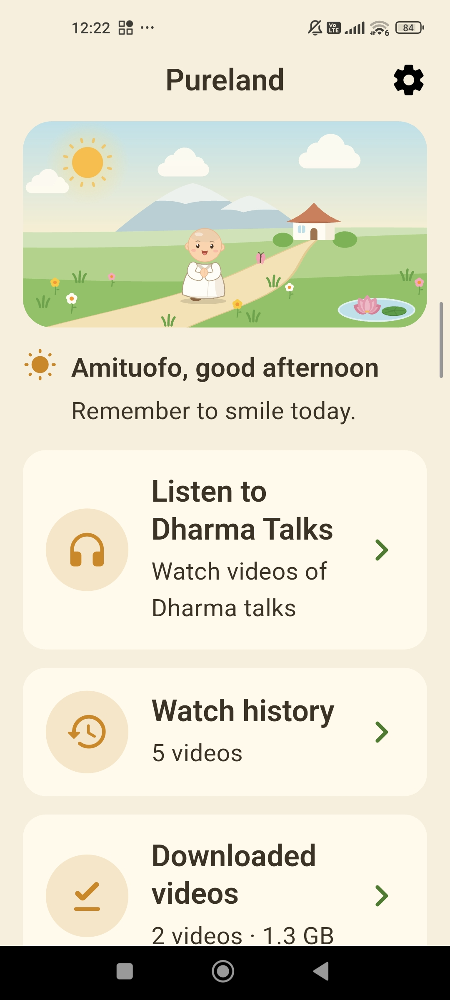
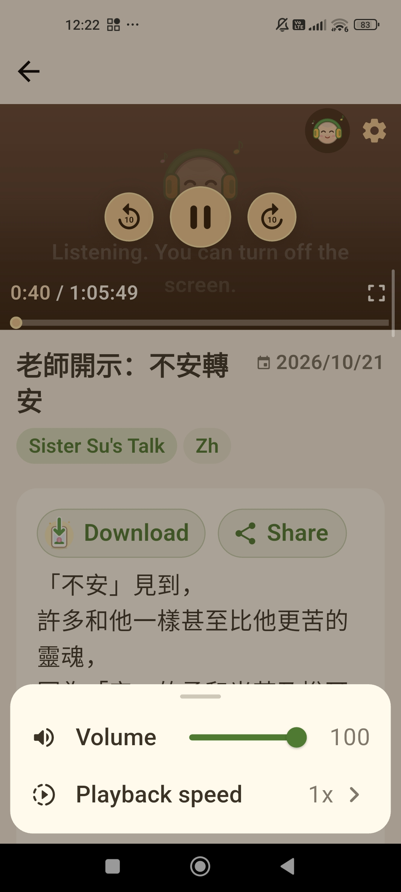
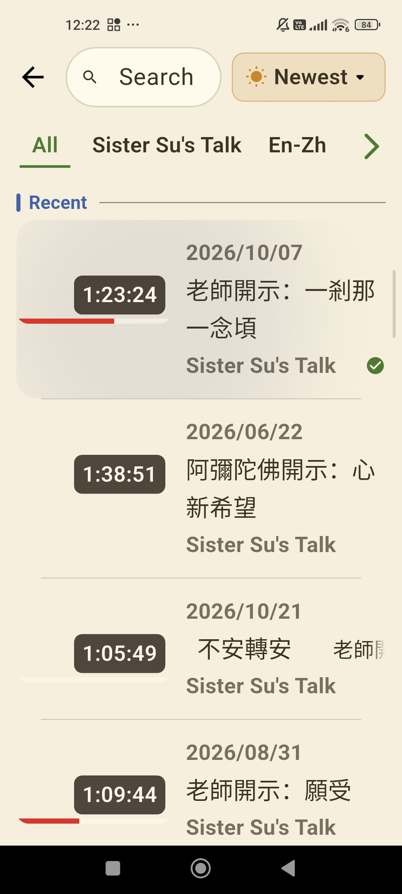
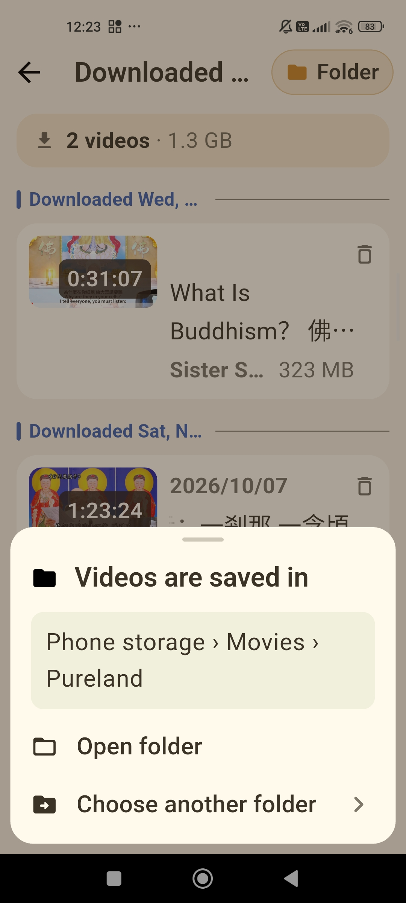
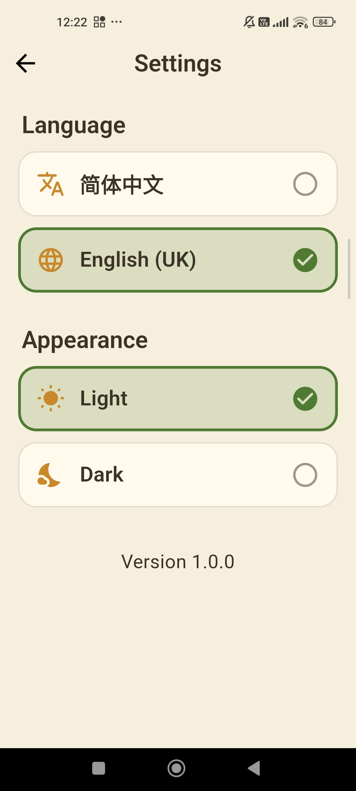

**v1.0.0 released · ongoing project · on pause while I prepare for my internship**

Pureland is an app for watching Buddhist media such as videos. About 20 people use it, most of them in China. It is bilingual (English and Mandarin).

**How I built it**

- Claude Code wrote all the code. I directed the work: what to build, design choices and testing.
- I asked the AI for UI wireframes, picked the best design and had it build that design into the app.
- I started with the basic features and added more step by step.
- In about 4 days I improved and tested it on my own Android phone, then released it to users.

**A change of plan**

At first I planned an open source template that anyone could set up with one JSON config file to host their own Buddhist media. But the scope was too broad for one person, and I had an internship and final exams coming up. So I dropped the open source plan and focused only on my current users.

